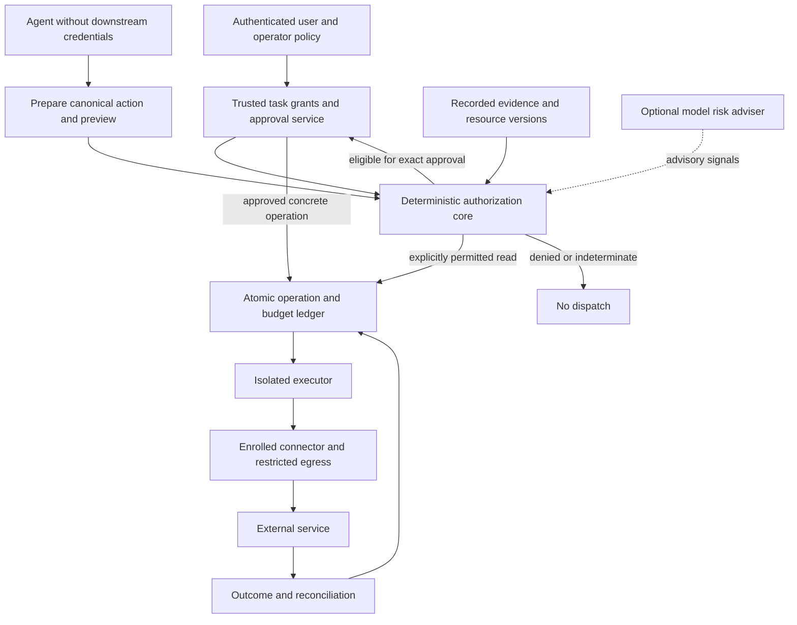

**Agent Action Guard: roadmap for strong research and dependable deployment**

**Scope update, 11 October 2026:** the user chose research-only completion followed by the refund project.
The active plan is [research-closeout-2026-10-11.md](research-closeout-2026-10-11.md). It supersedes the
implementation obligations and release gates below. This broader roadmap remains background for possible
future work; its production packages are not prerequisites for finishing the research project.

Prepared on 10 October 2026; final review on 11 October 2026 against commit `17e0884`.
Status: proposed implementation and evaluation plan.
Nothing in this document claims the proposed protections are already implemented or proved. The earlier
assessment is `docs/assessment-2026-10-10.md`. Its last verification on this same code snapshot was
225 passing tests, six documented expected failures, and passing lint/format checks.

The objective is the strongest defensible system within an explicit scope, together with independently
reproducible evidence. A numerical "10/10" is replaced by acceptance gates: correct enforcement, useful
authorization, credible research, safe integration and maintained operational assurance. Completing a feature
list is insufficient; evidence has to support the resulting claims. Excellent research can discover a negative
result. That result can satisfy scientific quality while preventing a production release.

**Scope and assumptions**

Banking and Slack remain the first research domains. The first deployment should expose one narrow connector
and operation set, initially in a sandbox, before expanding to both domains. An AgentDojo banking adapter is a
simulation, not a real banking integration. A real connector needs its own capability and failure-contract review.
Workspace/travel and broader frameworks are later generalization tests, not reasons to delay fixing known gaps.
Arbitrary browser, shell and code execution remain unsupported for a production claim until equivalent OS and
network enforcement exists. A future multi-agent deployment must share grants and budgets across agents.

Assume an attacker can control external documents/messages/pages, tool-result text and data-bearing arguments;
can propose malicious tool metadata; and can adapt attacks after observing decisions. Assume the agent can be
fully redirected and may attempt any exposed call. Trusted components are the enrolled connectors, authorization
service, identity provider, approval UI, execution service, policy registry and their host isolation. List the
assumptions for each connector; do not declare a remote implementation trusted merely because its schema is signed.

Compromised administrators, false but authentic documents, mistaken human approvals, malicious trusted upstream
services and unobservable side channels remain risks. Controls can reduce their impact; this plan does not promise
to eliminate them. False statements in final text are outside the current action guard's main claim. Disclosure
through final output is an egress path when that output is sent to another audience and must then be controlled.

The plan preserves **exact-call approval for every mutation by default**. Task permissions narrow what can be
approved; they do not silently replace approval. Bounded automatic execution, if later desired, is a separate,
explicitly selected, versioned product mode with its own evaluation and risk acceptance.

**Target architecture and authority**

The system answers three different questions: whether the principal can use the resource, whether the concrete
operation is within this task's authorization, and whether additional semantic uncertainty requires review.
Only the third question is primarily a model judgment.

The executor rechecks the applicable policy, approval, versions and budget before admitting dispatch. Neither
agent nor judge holds downstream write credentials, issues grants, changes the registry or approves its own work.
Server-side identity is authoritative; agent-supplied principal/tenant strings are never authentication.

Replace the flat warning list as the authorization signal with typed decisions and reason codes:

| Decision | Meaning |
|---|---|
| `DENY` | Mandatory policy violation. A model or ordinary user confirmation cannot waive it. |
| `REQUIRE_APPROVAL` | Eligible operation, requiring an authenticated exact-call approval. Warnings explain uncertainty. |
| `ALLOW` | Only an explicitly permitted read, or execution whose required authorization and exact approval are already satisfied. |
| `INDETERMINATE` | Invalid input, stale/missing mandatory evidence or a failed mandatory check. No dispatch until the issue is resolved and authorization is re-evaluated; ordinary approval cannot waive it. |

An authorized administrator may change an operator policy through a separate audited workflow. A user may revise
their task within that policy. Both changes produce new versions and invalidate affected pending approvals.
Warnings remain useful UI information, but "no warning" ceases to mean "authorized".

**Security invariants to specify, test and selectively verify**

- I1: Every supported security-relevant effect passes through the trusted executor and policy decision.
- I2: Unknown, malformed or changed tools/policies cannot acquire permission by default.
- I3: Every dispatched action is bound to authenticated principal, tenant, task, connector and resource scope.
- I4: Approval binds one canonical action, relevant object versions, schema/adapter versions and a validity period.
- I5: One approval admits at most one logical operation; concurrent workers cannot consume it twice.
- I6: Cumulative reservations prevent overspend and excess action count across workers and delegated agents.
- I7: Unapproved policy changes never enlarge permissions. Uncertainty never implicitly broadens a grant.
- I8: Revoked or expired permissions cannot admit new dispatch after the documented revocation boundary.
- I9: A timeout or unknown outcome does not restore permission, release its budget or trigger an unsafe retry.
- I10: Protected data cannot leave through an undeclared sink within the supported information-flow model.
- I11: A model verdict cannot override a hard constraint or upgrade attacker text into trusted evidence.
- I12: Secret values are absent from routine logs, telemetry and unnecessary model inputs.

These are proposed contracts. Formal work must state the environment and observation assumptions behind each;
proving a state machine does not prove a model understood the user or a remote tool truthfully reported its effect.

**Work packages: concrete changes, dependencies and acceptance evidence**

Each package below is required for the relevant claim or deployment surface. Optional research components are
marked. Existing filenames are current; new module names are proposed locations, not a requirement to create a
large number of separate services. Keep the trusted core small and the first deployment operationally simple.

**W00 — Freeze the baseline, threat model and claim boundaries.**

Preserve current traces/results and versioned configurations. Publish a capability matrix for hand-written rules,
automatic rules and hybrids, including the six expected failures. Define attacker control, trusted components,
supported connectors, high-impact effects and who can grant or revoke each permission. Write a decision record
for each major architectural choice and a threat-to-control-to-test matrix. No current development data is called
an untouched holdout. Record the current README/package-version mismatch and resolve it at release.

Files: `README.md`, `pyproject.toml`, existing policy/result docs; new threat-model and assurance documents.
Depends on: nothing. Done when every promised property has an owner, implementation boundary and evidence plan.

**W01 — Strict registry validation and one immutable prepared action.**

Fix the reproduced `effect="act"` fail-open path. Validate the loaded JSON, not just a model response schema:
effect/role enums, required keys, duplicate keys, unexpected properties, tool/argument coverage, types, nested
paths and resource limits. Expand the role vocabulary so amount, currency, recurrence, sensitive account fields,
selectors and outgoing content cannot all disappear into undifferentiated `content`. Describe read scopes too.

Bind operator-reviewed declarations to connector identity, schema/description hashes and adapter version.
Unreviewed tool descriptions are untrusted, including descriptions of tools the agent never executes. Schema or
implementation enrollment changes trigger review and invalidate affected pending requests. Existing effect tests
remain, but sample execution cannot prove a tool never has other effects.

Prepare one immutable representation after validation and default expansion. Authorization, preview and executor
use that same representation. Define domain-specific canonicalization: no password trimming; finite numbers;
minor monetary units plus currency or constrained decimals; stable directory/resource IDs; strict URL parsing.
Do not treat HTTP/HTTPS, arbitrary trailing slashes or host substrings as equivalent without connector semantics.
Reject unsafe ambiguity instead of making an approval hash conceal it.

Files: `automatic.py`, `planner.py`, `guard.py`, `approval.py`, `classify_tools.py`, `policies/*.json`;
proposed `schemas.py`, `tool_registry.py`, `canonical.py`. Depends on W00.
Acceptance: malformed/missing effects, omitted target roles, nested extra arguments, duplicate keys, renamed
fields, metadata drift and nonfinite values cannot silently dispatch. Property tests cover canonicalization.

**W02 — Task-specific permissions and deterministic authorization.**

Introduce a small typed grant: principal/task, permitted operations, exact destinations or bounded sets,
resource selectors, permitted field changes, quantity/currency, cumulative limit, count, expiry, data classes,
evidence references and approval requirements. Begin with equality, membership, upper bounds and conjunction.
Do not execute model-authored code or arbitrary regex as policy. Optional workflow prerequisites are explicit.

The clean planner drafts constraints; the trusted service issues them. A grant is issued from a preauthorized
operator template or after its material scope is confirmed by the authenticated grant issuer. Schema validity
and planner output alone cannot authorize scope. A single user interaction may confirm a bounded grant amendment
and approve its concrete action, with both decisions recorded. A mentioned value is not automatically
authorized, especially in negations, quotes or examples. Explicit "Alice" resolves to Alice's stable ID, not
all members. Missing identifiers produce unresolved fields and staged confirmation, not broad wildcards. An
exact action approval can resolve an uncertain task field within the operator's hard limits.

Keep a readable reference evaluator for the restricted grant language. For the multiuser production service,
evaluate Cedar for principal/action/resource authorization; choose OPA instead only if the deployment already
operates it. Do not add both. Adopt one only after a small compatibility spike confirms schema validation,
diagnostics, packaging and measurable benefit. Stateful budgets remain in the transaction layer, not in a
stateless policy evaluation. Default deny and hard-deny precedence apply regardless of implementation.

Files: `planner.py`, `automatic.py`, `banking.py`, `pipelines.py`; proposed `grants.py`, `authorization.py`.
Depends on W01. Acceptance: Alice-to-Bob, wrong channel, wrong transaction ID, currency substitution, unauthorized
recurrence, extra field changes and negated recipient examples are denied or explicitly reviewed. An overbroad
but schema-valid initial draft never acquires authority automatically. An always-clear fake judge cannot bypass
hard constraints. Legitimate aliases and alternate valid tool sequences remain supported.

**W03 — Restore domain protections and enforce complete effects.**

Compose automatic policy with independent banking amount and personal-data checks. W4/W5 remain useful warnings,
not proofs of authorization. A permitted history-relative amount is still constrained by the task grant and
cumulative budgets. Preview a changed scheduled payment as its complete resulting state, including fields that
the provider interprets as unchanged. Do not rely only on the arguments visibly present in the call.

Require dedicated permissions for address/password/account changes. For Slack, separate reading a channel,
publishing to it, inviting a person, and removing a member. Check content and links even for known recipients.
Add task/action-specific rejection constraints, bounded retries and a circuit breaker; a prompt saying
"do not retry" is not enforcement. Exact payload repetition and equivalent effects via another tool both matter.

Files: `banking.py`, `automatic.py`, `guard.py`, `adaptive_tests.py`, `tests/test_known_gaps.py`.
Depends on W02. Acceptance: A2/B1/B2/C1, phishing to a known user and unauthorized member removal have explicit
safe outcomes in every supported configuration, while legitimate twins stay achievable. Remove each `xfail`
only when its real protection is implemented and tested. Include many small payments, changed selectors,
recurring charges and data hidden in subjects/attachments. No blanket "reject all" passes this gate.

**W04 — Recorded evidence and constrained information flow.**

Introduce evidence handles recording connector, call ID, resource/version, field/path, retrieval time, digest,
integrity/confidentiality labels and parent transformations. Retrieve and transform sensitive values inside
trusted adapters where practical; have the agent reference handles instead of rewriting protected arguments.
Maintain three separate properties: observed source, authenticated source and authorized use. A digest proves
integrity relative to a snapshot, not truth. A correctly named, authentic document can still contain false data.

Treat current string occurrence as a heuristic during migration. Model extraction is untrusted proposed data;
a JSON schema does not make it true. For unconstrained LLM output, conservatively retain sensitivity of context
it could use. Only approved bounded transforms or explicit disclosure authorization reduce restrictions; another
model claiming a safe source does not. Apply controls to tool outputs, future memory, final messages, URLs,
attachments and model-provider requests, not just conventional writes. Partition sensitive contexts to reduce
overblocking. If causal tracking is incomplete, report that limitation instead of claiming noninterference.

Secret scanning and semantic content assessment are auxiliary checks. Structural sink permissions and templates
for high-risk fields provide stronger bounded protection against encoding/paraphrase leakage. When independent
verification is absent, a changed payee/address needs actual confirmation rather than a provenance-based pardon.

Files: `banking.py`, `automatic.py`, `judge.py`, `guard.py`; proposed `evidence.py`, `data_policy.py` and adapters.
Depends on W01-W03. Acceptance: forged expected sources, same value in multiple sources, wrong-resource matches,
computed values with wrong operands, encoded/split disclosure and quoted malicious instructions are tested with
benign twins. Trust labels cannot be changed by agent text. Publish which flows are tracked and which are not.

**W05 — Bounded replanning and an advisory judge.**

Allow a task plan to refine within the issued grant. Compare old/new permission sets mechanically; unknown
comparisons count as potential expansion. Newly discovered recipients, spend, resource scope or effects need a
separate authenticated grant update. Read permission never implies permission to execute all instructions read.
Bound nested delegation and keep budgets shared. Preserve user corrections as a new task version.

Replace a binary judge override with structured observations: risk reasons, evidence IDs, uncertainties and
recommended review. It may resolve explicitly designated soft uncertainty, but cannot clear operator restrictions,
exact user constraints, secret rules or ledger checks. Judge timeouts and malformed answers never expand rights.
Keep context minimal and mark argument strings as untrusted. Repeated votes are not independent security evidence.

Use deterministic rules as the current banking reference unless new held-out evidence supports a judge's added
value. Compare selective content judging in Slack. An injection sanitizer is an optional ablation, not a new
trust boundary. Cache judgments only when all relevant request/evidence/policy/model identities match; never
cache a replayable execution approval as a model verdict.

Files: `planner.py`, `judge.py`, `automatic.py`, `pipelines.py`; proposed grant-diff and task-version modules.
Depends on W02-W04. Acceptance: legitimate document-driven tasks can progress through bounded refinement;
malicious documents cannot broaden permissions. A fixed false-clear judge and an unavailable judge preserve
hard invariants. New judge/sanitizer components earn inclusion through safe completions, cost and latency.

**W06 — Isolated executor and connector contracts.**

Extract a framework-independent core behind `prepare`, `authorize`, `approve`, `execute`, `reconcile` and `audit`
interfaces. Retain AgentDojo as one adapter. Start a trusted broker/executor outside the agent process, with a
restricted filesystem and network identity. Separate processes under identical unrestricted credentials are
insufficient isolation. Give the agent no downstream credentials or direct route to protected effects.

Each enrolled adapter declares effects, read/data scopes, validation/canonicalization, preview semantics,
version checks, idempotency support and retention, timeouts, partial effects, and reconciliation capability.
If a tool changes behavior behind unchanged metadata, deployment identity and connector review must detect or
bound it. Avoid generic "execute arbitrary tool name" endpoints. Batch operations expand into individually
authorized effects; nested reads with external effects receive their own checks.

Implement one narrow sandbox connector first. A connector that lacks safe version checking or reconciliation
gets a weaker, explicit capability rating and restricted operation set. Production readiness is per connector,
not inherited automatically from the common core. Shell/browser adapters are separate future threat models.

Files: `guard.py`, `pipelines.py`; proposed `executor.py`, core interfaces, `adapters/agentdojo.py` and sandbox adapter.
Depends on W01-W04. Acceptance: direct API access from the agent, bypassing the wrapper, arbitrary target tools,
stolen proposal handles and unauthorized network paths cannot produce effects. Contract tests compare preview,
actual resulting effect and provider error behavior for each supported operation.

**W07 — Durable approvals, budgets, idempotency and revocation.**

Store random opaque approval/operation IDs and immutable payloads in a transactional ledger. Bind tenant,
principal, delegated agent, task/grant, connector/tool, schema/adapter version, resource versions, policy epoch,
expiry and exact arguments. Prefer server-side records initially rather than inventing signed bearer tokens.
Use established authentication/cryptographic libraries if cross-service assertions become necessary.

Atomically check permissions, consume approval and reserve amount/count/rate capacity before dispatch. Budgets
apply across workers, tasks where appropriate, and delegated agents. Different currencies have independent limits
unless an explicit trusted conversion policy exists. Reserve capacity for uncertain outcomes; do not refund it
on timeout. A persistent outbox links committed operations to executor work. Remote calls occur outside DB
transactions; a DB rollback cannot undo a remote payment.

Model `PROPOSED`, `APPROVED`, `RESERVED`, `DISPATCHING`, `SUCCEEDED`, `FAILED_FINAL`, `UNKNOWN`, `DENIED`, `EXPIRED`
and `REVOKED` transitions explicitly. Use uniqueness/compare-and-swap to prevent duplicate admission. Resource
preconditions such as ETags must be enforced by the remote API; a local re-read alone does not close the race.
Define the revocation linearization point. Already admitted remote actions may be irreversible.

Each dispatch attempt requires durable compare-and-swap ownership. Duplicate queue deliveries cannot start
competing attempts. For non-idempotent providers, lease expiry or worker loss after dispatch begins must not
trigger automatic takeover/retry: retain UNKNOWN until reconciled. A local fencing token is insufficient unless
the downstream system enforces it.

For providers with idempotency, retry the same logical operation with the same payload/key only within the
supported window and reconcile. For providers without it, an ambiguous outcome stops automatic retries.
Two intentionally identical operations need distinct IDs plus grant capacity; fresh attacker IDs cannot bypass
budgets. Promise at-most-once admission and adapter-specific remote semantics, not universal exactly-once effects.

Files: `approval.py`, `guard.py`; proposed `approval_store.py`, `ledger.py`, `budgets.py`, `reconciliation.py`.
Depends on W02 and W06. Acceptance: competing workers never exceed a grant; crash injection at every transition,
lost replies after success, duplicate callbacks, changed payloads, expired keys, restore/replay and revocation
races preserve the contract. Every UNKNOWN is visible, retains reservations and has an actionable runbook.
Pause worker A after dispatch begins, expire its lease, deliver the operation to worker B, then resume A;
no duplicate non-idempotent effect is permitted.

**W08 — Identity, network isolation, secret handling and the approval interface.**

Use authenticated identities and resource ownership checks on every service request. Verify audience, issuer,
expiry and scopes; never authenticate by task ID alone or forward an incoming token unchanged to another API.
Maintain least-privilege downstream credentials in the executor. If MCP is exposed, pin the selected protocol
version and implement its authentication and security rules separately from task authorization.

Restrict egress at the network layer and connector layer. URL-bearing reads can exfiltrate via path/query,
headers or redirects. Validate actual destinations and every redirect; address DNS rebinding, IPv6/alternate
address forms and metadata/internal endpoints. Do not let the model choose a credential-bearing destination.
Control what data reaches planner/judge providers; supply only the minimum necessary facts.

Use a trusted authenticated approval UI generated from the prepared action. Show recipient, amount/currency,
before/after changes, recurrence, data disclosed, remaining scope and uncertainty. Escape HTML, terminal control
characters and bidirectional text; make truncation visible and critical fields fully inspectable. Guard against
CSRF, clickjacking, stale tabs and forged callbacks. High-impact operations may require step-up authentication.
Do not frame the model's explanation as proof. A batch approval enumerates a fixed set and does not approve
future additions. Keep an accessible reject/cancel path and a clear outcome/UNKNOWN screen.

Collect credentials via a trusted widget or secret reference, resolving only in the executor. Protect detailed
evidence separately; routine logs contain decision metadata and safe commitments, not passwords/tokens/private
payloads. A plain hash of a guessable secret is not safe redaction. Define retention/deletion and audit access.

References used as action arguments bind immutable versions or protected content commitments in the approved
envelope. Resolving a handle to different content invalidates approval. This includes new-password values,
attachments and evidence handles. Distinguish them from transport credentials, whose authorized rotation need
not change the action.

Files: `approval.py`, `guard.py`, `judge.py`; proposed service auth, UI, secret references, egress and audit modules.
Depends on W06-W07; prototypes may start earlier. Acceptance: cross-tenant IDs, malicious display text, replay,
stolen handles, mismatched token audience, redirects, direct egress and synthetic secret canaries all have tests.
No canary secret reaches routine logs, error output or unnecessary model requests. Rotating a referenced
new-password value or replacing an attachment after approval rejects execution of the changed argument.

**W09 — Property tests, formal state model and independent security review.**

Build stateful/property tests for grants, approval transitions, canonicalization and budgets. Use generated
action sequences and a simple reference state machine; test concurrency and crash recovery against the actual
store/executor. Mutation tests should demonstrate that removing a critical check makes its tests fail. Add
parser/resource exhaustion and denial-of-service cases, not only attacker-success cases.

Model the approval/ledger/revocation protocol in TLA+/PlusCal or an equivalently reviewable formalism. Check
at-most-once admission, budget conservation, no stale-approval dispatch and bounded policy expansion under stated
assumptions. Map model transitions back to implementation traces. This verifies a bounded protocol, not the LLM,
all application code, arbitrary remote APIs or the truth of source documents.

Commission independent review of the trusted core and the first adapter before sensitive production use.
Provide architecture, threat model and a test environment; retain all findings and retest fixes independently.
Reviewers must have a route to report issues without sharing production secrets. No unresolved critical/high
finding affecting an enabled sensitive path passes the production gate.

Files: critical modules and tests; proposed `spec/`, state-machine tests and assurance matrix.
Depends on W01-W08 incrementally. Acceptance: each invariant maps to checks and adversarial tests; modeled
assumptions are exercised at the adapter boundary; independent review and fault/load tests are documented.

**R01 — Repair labels, cohort validation and evidence publication first.**

Replace overloaded labels with separate dimensions: authorization, task correctness, attacker/error origin,
attempted/rejected/executed/partial effect, severity and ambiguity. Correct the C1 leakage case. A payment with
the right recipient/amount is not safe-correct if its subject discloses protected data. Allow valid alternative
solutions; do not label only exact reference trajectories as correct. Warned agent mistakes are not false
positives. Two reviewers adjudicate ambiguous/high-impact examples and a stratified sample independently.

Share one cohort validator across report, compare and bootstrap. Validate expected cells, unique run IDs,
manifest compatibility, paired coverage and corrupt/missing/interrupted rows. Preserve canonical benchmark scores
beside execution/effect diagnostics. Record task infeasibility caused by overwritten essential data separately.
Do not silently erase failures from headline denominators; publish best/worst-case sensitivity for unknown effects.
Provisional progress cannot overwrite final artifacts; writes are atomic and trace inventories checksummed.

Extend run manifests with task/environment/split hashes, attack implementation and budget, sampling/timeout/retry
settings, model identity/fingerprint where available and dates. Add a separate evaluation manifest for scoring
code, label rubric, exclusions, statistical method and seed. Record invocation subsets without preventing valid
resume. Capture all attempts needed for replay, rather than just a final transcript.

Files: `labels.py`, `guard_metrics.py`, `metrics.py`, `manifest.py`, `planner_replay.py`, `report.py`, `compare.py`,
`bootstrap.py`, reporting tests. Depends on W00; run in parallel with W01.
Acceptance: unsafe C1 fails safe-correct; mixed/incomplete cohorts cannot publish final results; a fresh checkout
reconstructs saved tables offline; historical definitions remain identifiable and raw evidence unchanged.

**R02 — Three complementary adversarial test tracks.**

Track A supplies counterfactual calls at each benign execution prefix, including calls no current injection
elicited. Measure unnecessary privileges and required-call sufficiency separately. Extend the existing replay
with changed recipients, amount, selector, count, data, tool and order; include correct-source poisoning,
memory contamination, task-switching and hostile catalog descriptions. Maintain benign twins and independent
authorization labels. Ajar is a relevant diagnostic design, not an automatic correctness oracle.

Track B evaluates the full agent under adaptive attacks. Integrate AutoDojo or a compatible audited harness over
AgentDojo first, then a held-out AgentDyn slice for dynamic behavior. Keep static attacks as historical
comparisons. Treat `tool_knowledge` as a related second template, not independent adaptive validation. Add
metadata-poisoning cases inspired by MCPTox in isolated fixtures; do not run untrusted live servers blindly.

Track C attacks production boundaries: identity, approval spoofing, duplicate execution, partial effects,
schema drift, egress, denial of service and crash/restart. Mock attacks alone cannot validate isolation or remote
semantics; these tests use the actual sandbox deployment and connector contract.

For adaptive campaigns predeclare attacker knowledge, allowed edits, victim-query/token/time budgets and state
resets. Suggested development budget curves are 1, 10, 50 and 100 attempts per campaign. They are planning choices,
not standards. Compare defenses under equal opportunities, log all attempts and revalidate candidate successes on
fresh runs. Distinguish per-attempt success from success anywhere in a campaign. Independent red-team campaigns
follow developer attacks. Never expose real credentials or user data to an attack harness.

Files: `adaptive_tests.py`, replay tools, new adversarial harness/fixtures and protocol docs.
Depends on R01 and candidate protections; fixture development starts earlier.
Acceptance: coverage matrix includes known destination abuse, split actions, transformed data, forged expected
sources, planner/judge/catalog attacks, mutable selectors, delayed attacks and benign dynamic instructions.

**R03 — Frozen, powered and fairly matched experiments.**

Treat all inspected banking/Slack cases as development or historical validation. Split new work by task family,
environment and attacker strategy, not random rows. An independent evaluator controls the confirmatory set;
near-duplicate documents/paraphrases stay in one split. Freeze prompts, rules, judge thresholds and analysis
before revealing results. Changes after inspection require a new holdout; local novelty does not establish
that a public benchmark was absent from a model's training data.

Use at least three contrasting agent setups for a broad model-transfer claim: the historical small model,
a current more capable model and a model from another provider where feasible. Pin actual available identities
when the protocol is frozen rather than selecting transient names now. The minimal diagnostic pilot uses two.
Match tools, environment, task budget, scoring and agent loop; interleave configurations to limit provider drift.

Baselines: undefended agent, explicit approval-only control, tool filter, current rules/hybrid and the candidate.
Reproduce at least one compatible strong public defense under the same harness before claiming comparative
leadership. If that is infeasible, state the comparison limit. Ablate grant constraints, amount/content checks,
evidence handling, judge and replanning; evaluate optional sanitization separately. Report results by domain,
model, attacker family and task specificity (fully specified, unknown parameters, unknown actions).

Predeclare the approver protocol: displayed information, decision rule, intervention budget, rejection/retry
behavior and access to benchmark truth. Compare guard variants under the same approver where possible; label
native autonomous defenses separately. Retain approve-all, reject-all and follow-warnings as behavioral
diagnostics. Oracle approval is a privileged diagnostic using benchmark attacker values, not a deployable policy
or a bound on real-user performance. Additional human/oracle authority must not masquerade as a better guard.

Primary endpoints: proportion of assigned episodes with at least one unauthorized effect, safe task completion
(task done with no unauthorized effect), and clean completion on tasks requiring an action. Also report open
privilege, severity, effect counts, exposure/reached-guard diagnostics, human approvals, false rejections,
unknown outcomes and all API failures.
Use total assigned episodes for the headline endpoint, not only attacks that reached the guard. Cost includes
agent/planner/judge, failed runs and retries; report cost per safe completed task as well as per episode.
Separate human waiting time from deterministic-check, model and external-service latency; report p50/p95/p99.

Use paired task-cluster analysis for a fixed attack set. Declare task weighting. Broader claims across attack
families require accounting for task/campaign dependence and per-family sensitivity, not naïve pooling. With few
families, explicitly restrict the inference. Predeclare primary comparisons and multiplicity handling. No
optional stopping or selective reruns after favorable outcomes.

Proposed competitive target: clean/action-task utility noninferiority within 3 percentage points per supported
domain, plus a meaningful security improvement against matched baselines. The 3-point margin is a proposed
product decision, not a safety standard. Passing requires the relevant confidence bound to clear the margin;
an interval containing zero does not demonstrate equality. If both defenses have no observed failures, the data
do not demonstrate security superiority. Publish that outcome honestly.

Determine sample size from a development pilot and simulation of the clustered design. Do not promise adequate
power from an arbitrary 100 tasks. Illustratively, a simple paired binary 3-point noninferiority comparison at
one-sided alpha .025, 80% power and 10% discordance, assuming the true utility difference is zero, needs roughly
873 independent pairs under a normal approximation; real repeated/crossed designs need their own calculation.

For independent identically distributed Bernoulli trials with zero observed failures, a one-sided 95% upper
bound is `1 - 0.05 ** (1/n)`. Below 1% needs 299 independent zero-failure trials; below 0.1% needs 2,995.
These examples are not deployment risk thresholds. Repeats of 16 tasks and adaptive attempts within one campaign
do not supply that number of independent deployment scenarios. Risk tolerance for each enabled high-impact
operation is explicitly chosen before its pilot; an unmeasured bound is an unmet gate.

Files: protocol and analysis docs, runner, cohort/stats modules, benchmark adapters.
Depends on R01-R02 and a frozen candidate. Acceptance for research quality: complete preregistered evidence,
honest uncertainty and independently reproducible results, including negative results. Acceptance for product
effectiveness is a separate risk/utility decision and cannot be passed by publication alone.

**R04 — Human approvals and independent reproduction.**

Start with 8-12 representative participants in simulated tasks to find confusing approvals, hidden destinations,
fatigue and cancellation problems. This is formative evidence, not a rare-error estimate. Follow with a powered
study using participant/task clustering and counterbalanced interfaces. Measure unauthorized approvals,
unnecessary rejections, comprehension, time, repeated-prompt fatigue and recovery. Do not use actual harmful
payments or disclose participant secrets. High-impact hard constraints must not depend on perfect vigilance.

Package code, fixtures, schema versions, locked dependencies, synthetic traces, checksums and evaluation manifests
so another person can reconstruct reports without paid model calls. Separate replay reproducibility from rerunning
stochastic APIs. Provide a third party with instructions and record reproduction discrepancies. Publish a claim
matrix with supporting artifacts and limitations; compare architecture and measurements without cross-paper
headline rankings. A strong contribution is the combination of enforceable authorization and useful evidence,
not merely adding another judge to the literature.

Files: approval UI, study protocol, README, release artifacts and assurance report.
Dependencies: formative work starts with a usable W08 prototype, before freezing confirmatory interfaces and
protocols. The powered confirmatory study and final reproduction depend on R01-R03. Acceptance: problems found
in formative work are addressed; confirmatory user evidence matches the intended audience; an independent
reproduction succeeds or unresolved differences are disclosed.

**W10 — Secure delivery, operations and staged rollout.**

Add CI across supported platforms/Python versions, locked builds, dependency vulnerability and secret scanning,
minimal CI permissions, reviewed/pinned workflow dependencies and published artifact provenance. Maintain an SBOM
and a tested update policy. Start with a simple supported deployment, not unnecessary microservices. Protect
policy changes and release credentials; audit migrations and rollback. Production logs are access-controlled,
tamper-evident and privacy-minimized, distinct from synthetic benchmark traces.

Instrument decisions, overrides, policy versions, reservations, retries, UNKNOWN backlog, false approvals,
latency, cost and drift. Put task/global rate limits and circuit breakers outside model control. If the mandatory
ledger or policy service is unavailable, protected effects stop; recovery must not turn an outage into bypass.
Document emergency stop, incident triage, revocation, key rotation, recovery and unknown-outcome reconciliation.
Exercise backup restore and stop/rollback procedures before enabling sensitive operations.

Roll out in order: shadow decisions with no executor authority; sandbox actions; a bounded low-impact canary
with exact approvals; gradual expansion after evidence gates. Shadow mode by itself does not protect an existing
unguarded agent. A real banking connector is not the first uncontrolled pilot. Restrict disabled or weakly
supported operations visibly. Repeat regression/red-team checks after model, connector, policy or dependency
changes, and maintain new holdouts. This roadmap does not create any automation or authorize a deployment.

Files: CI, packaging, deployment/service configuration, observability and runbooks.
Depends on W06-W09 and pilot evidence; supply-chain work starts earlier.
Acceptance: restore/kill-switch/key-rotation drills succeed, no unresolved high-impact finding, performance and
cost meet a declared workload budget, and the operator can identify and reconcile every uncertain action.

**Research and deployment gates are separate**

| Gate | Required evidence | What failure means |
|---|---|---|
| G0: baseline and scope | Frozen artifacts, threat model and claim/control/test matrix | Do not make broader claims. |
| G1: evaluator and immediate safety | W01/R01 pass; no malformed-policy silent execution; trustworthy labels/cohorts | No new final performance publication. |
| G2: semantic candidate | W02-W05; known attacks and valid twins across supported configurations | Continue development; do not hide gaps in an aggregate score. |
| G3: enforcement boundary | W06-W09; isolation, replay, concurrency, revocation and faults independently tested | No real sensitive execution. |
| G4: research artifact | R02-R04 protocol, matched results, uncertainty and reproduction | Label findings exploratory; retain negative evidence. |
| G5: product effectiveness | Predeclared security/utility/burden targets achieved for the enabled scope | Narrow scope or improve; a paper does not waive this gate. |
| G6: limited production | W10 drills, representative load, user evidence, connector-specific risk approval | Stay in sandbox or shadow mode. |
| G7: sustained assurance | Drift review, fresh attacks, incident response and maintained artifacts | Pause affected capabilities and reassess. |

Suggested performance targets are fixed after representative workload measurements in G0/G1. No fixed latency
number is asserted here without hardware, provider and traffic assumptions. No unresolved critical invariant
bypass is acceptable in any enabled production path. Model errors are measured residual risk and cannot be
turned into deterministic guarantees by declaring a low benchmark ASR.

**Dependency order and implementation slices**

| Slice | Packages | Deliverable and gate |
|---|---|---|
| 1 | W00, W01, R01 | Trustworthy baseline, fail-closed registry and validated result pipeline; G0/G1. |
| 2 | W02, W03; begin W04/R02 | Task grants and complete-effect checks; known attack/twin matrix. |
| 3 | W04, W05 | Evidence handles, content constraints and bounded dynamic work; G2. |
| 4 | W06, W07; begin W08/W09 | Framework adapter, isolated executor and durable operation lifecycle. |
| 5 | W08, W09, W10 foundations; formative R04 | Trusted interface, auth/egress/secrets, usability feedback, protocol model and independent review; G3. |
| 6 | R02, R03, R04 | Frozen adaptive/dynamic evaluations, powered analysis, user study and reproduction; G4/G5. |
| 7 | W10 rollout | Connector-specific shadow/sandbox/canary and recovery evidence; G6. |
| 8 | Maintained W09/W10/R02-R04 | New attacks, drift assessment, patches and restricted expansion; G7. |

Candidate version labels may be v0.3 evidence freeze, v0.4 policy/evaluator repair, v0.5 constrained dynamic
authorization, and a v1.0 release candidate after the executor and evidence gates. Version numbers are bookkeeping,
not claims that a stage is complete. Keep changed experiments in new versioned run directories.

The first reviewable implementation sequence is: registry schemas/fail-closed behavior; label/cohort corrections;
immutable prepared actions; explicit destination/selector constraints; banking/content regressions; shared budgets
and operation identity. These can be small reviewed changes rather than a rewrite. Extract interfaces around the
existing tested gate before replacing its storage/runtime integration.

**Resources, cost control and decisions to make at the relevant gate**

This is a multi-month engineering and validation program, not a few prompt edits. A rough planning allowance for
one experienced full-time engineer, assuming available sandbox APIs, is 1-3 weeks for slice 1, 4-8 further weeks
for slices 2-3, and 6-12 further weeks for slices 4-5. Research, independent review and user/pilot work can add
4-10 or more calendar weeks and partly overlap. These are estimates with substantial uncertainty, excluding
provider onboarding and recruitment delays; re-estimate from completed slice 1. Two engineers can parallelize
policy/evaluation and infrastructure, but independent assessors and users cannot be replaced by more coding agents.

Do not spend on a full Cartesian product of every defense/model/attack. Use free fixtures and stored replay,
then a small development pilot to estimate total victim, planner, judge and attacker calls plus retries. Price
the frozen matrix at the actual provider rates and set a project-wide budget before paid execution. Confirmatory
experiments do not stop merely when their results become favorable. Narrow claims if the powered design exceeds
resources; do not substitute many correlated repeats for independent evidence.

The existing `prerun-check` skill is part of the implementation workflow: changed run-file inventory, manifest
compatibility, tests/lint, replay of stored requests, every value-matching site and mock end-to-end prompts.
Its helper files currently live under `.agents/skills/prerun-check/`, while examples still refer to `.Codex/`;
make a portable documented command before automating it. Review every intended replay difference. Run the mock
with an explicitly local endpoint and isolated short output directory; it must never write final results.
No paid command or paid run is issued by this planning task.

Retain the repository's maximum of three benchmark processes and one writer per suite/repeat, adding a lock to
enforce it. Respect actual rate limits. Strengthen spend accounting: current cost is checked before the next
call, so a call can overshoot a nominal limit. Reserve a conservative bounded request cost when possible, cap
output, account for retries/missing usage and coordinate across processes. Do not advertise an absolute billing
guarantee the API cannot enforce. Record actual spend and uncertainty.

Deployment choices are resolved before their dependent implementation: first connector and operation set;
single-user versus multiuser service; identity/credential provider; persistent store and hosting boundary;
operator policy authority; privacy/retention requirements; impact-specific risk tolerance; traffic and latency
budget; independent evaluator and study participants. Defaults in this plan enable work now, but these choices
must be explicit before claiming production readiness.

**How the assessment's findings are covered**

| Current issue | Planned remedy | Evidence |
|---|---|---|
| Malformed tool entry bypass | W01 | Invalid-entry/schema-drift tests, real dispatcher probe |
| Missing amount/account/PII coverage | W02-W04 | A2/B1/B2/C1 plus legitimate twins for every policy |
| Familiar destination treated as permission | W02/W03 | Wrong known recipient, selector and content probes |
| Static plan overblocks dynamic tasks | W05 | Benign dynamic tasks plus malicious expansions |
| Literal occurrence mistaken for authority | W04 | Evidence/transform/source-poisoning tests |
| Judge adds cost or clears unsafe requests | W05/R03 | Per-domain ablations; always-clear judge test |
| Misleading correctness/false-warning labels | R01 | Effect-sensitive gold fixtures and independent adjudication |
| Partial/mixed result publication | R01 | CLI integration tests, manifests and artifact reproduction |
| Repetition mistaken for generalization | R02/R03 | Family holdout, adaptive campaigns, clustered inference |
| In-process enforcement and weak lifecycle | W06-W09 | Isolation, crash/concurrency/revocation/idempotency tests |
| Secret/log/approval-interface risk | W08/R04 | Canary tests, UI attacks and user comprehension study |
| Incomplete release/operational story | W00/W10/R04 | Current docs, reproducible artifacts and recovery drills |

**Research and engineering sources informing the choices**

Sources were checked as of 10 October 2026. The recommendations above are design proposals for this repository;
they are not claims that adopting a cited library reproduces a paper's guarantees or results.

| Primary source | Specific lesson used |
|---|---|
| [CaMeL v2](https://arxiv.org/html/2503.18813v2) | Separate control and data and attach capabilities to values; runtime enforcement is stronger than guessing origins from strings. |
| [Fides v2](https://arxiv.org/html/2505.23643v2) | Quarantined extraction and selective information access; typed extraction still needs trust/flow rules and its secrecy claim has explicit scope. |
| [Progent v3](https://arxiv.org/html/2504.11703v3) | Compare permission narrowing and expansion mechanically. Initial-policy correctness and explicit expansion approval remain assumptions; reported auto-approve experiments are not the same guarantee. |
| [AuthGraph](https://arxiv.org/html/2605.26497v1) | Separate clean authorization from execution provenance; attribution errors and poisoned authoritative sources limit the inference. |
| [DRIFT v3](https://arxiv.org/html/2506.12104v3) | Dynamic validation and memory sanitization address different failures; keep their contributions and costs separately measurable. |
| [FORGE v3, formerly PCAS](https://arxiv.org/html/2602.16708v3) | Formal enforcement depends on sound and sufficient observation facts; publish that environment contract with any theorem. |
| [Ajar](https://arxiv.org/abs/2609.26900) | Measure unnecessary privileges and required-call sufficiency in addition to live ASR. |
| [AutoDojo v3](https://arxiv.org/html/2606.15057v3) | Use defense-adaptive attacks and distinguish task specificity; low attack success under static attacks can overstate robustness. |
| [AgentDyn v3](https://arxiv.org/html/2602.03117v3) | Test dynamic workflows and useful third-party instructions to expose security/utility tradeoffs. |
| [MCPTox v2](https://arxiv.org/html/2508.14925v2) | Hostile tool metadata can affect an agent before the tool executes; the catalog needs an enrollment boundary. |
| [AutoCedar](https://arxiv.org/html/2607.03656v1) | Review the intended authorization target before verifying generated policy against it; compilation is not semantic correctness. |
| [Cedar authorization](https://docs.cedarpolicy.com/auth/authorization.html) | Default deny and forbid precedence are useful; policies with evaluation errors are skipped, so our wrapper must treat unexpected diagnostics as indeterminate and validate inputs. |
| [MCP authorization](https://modelcontextprotocol.io/specification/2026-07-28/basic/authorization) and [security guidance](https://modelcontextprotocol.io/docs/2026-07-28/tutorials/security/security_best_practices) | Transport identity is separate from task permission; enforce token audiences, forbid passthrough and protect workflow handles and network fetches. |
| [OWASP transaction authorization](https://cheatsheetseries.owasp.org/cheatsheets/Transaction_Authorization_Cheat_Sheet.html) | Bind meaningful server-controlled transaction data to unique, time-bounded approval and recheck before execution. |
| [OWASP SSRF prevention](https://cheatsheetseries.owasp.org/cheatsheets/Server_Side_Request_Forgery_Prevention_Cheat_Sheet.html) | Address redirects, resolution and internal destinations at more than the URL-string layer. |
| [Stripe idempotency](https://docs.stripe.com/api/idempotent_requests) | A remote idempotency key has retention and payload rules; a durable local approval does not by itself prevent every duplicate remote effect. |
| [Hypothesis stateful testing](https://hypothesis.readthedocs.io/en/latest/stateful.html) and [Lamport on formal methods](https://lamport.azurewebsites.net/tla/formal-methods-amazon.pdf) | Explore sequences/concurrency against explicit invariants, with formal models limited to their assumptions. |
| [NIST interval methods](https://www.itl.nist.gov/div898/handbook/prc/section2/prc241.htm), [Owen/Eckles crossed-factor bootstrap](https://arxiv.org/abs/1106.2125) and [adaptive data analysis](https://arxiv.org/abs/1411.2664) | Match uncertainty calculations to dependence and avoid repeatedly adapting claims to the same test data. |
| [NIST AI 600-1](https://nvlpubs.nist.gov/nistpubs/ai/NIST.AI.600-1.pdf) | Use deployment-relevant evaluation, independent assessment and structured feedback; narrow tests do not support universal conclusions. |
| [NIST SSDF 1.1](https://csrc.nist.gov/pubs/sp/800/218/final) and [SLSA 1.2 build track](https://slsa.dev/spec/v1.2/build-track-basics) | Secure development and build provenance support maintained assurance beyond benchmark code. |

The endpoint is a maintained assurance case: which actions are supported, which invariants are enforced,
which risks remain, what independent tests found, and what causes a capability to be suspended. It is not
a permanent perfect score, and a new connector, model or privilege mode must earn its own evidence.
